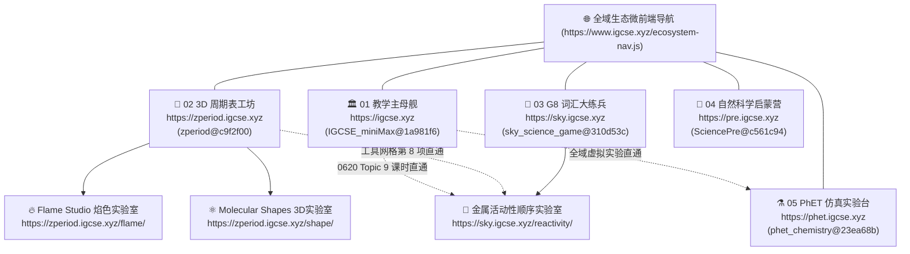
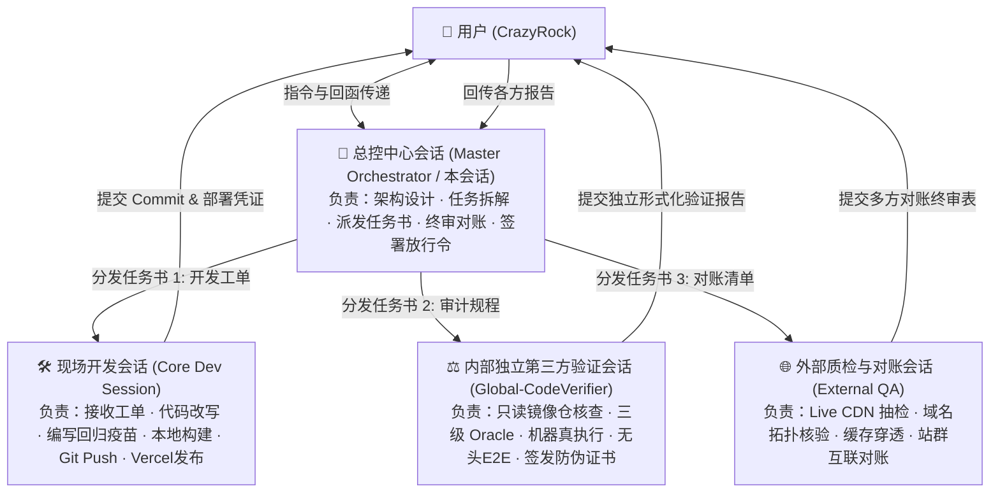

# 🏛️ IGCSE 科学教学生态站群：全域工程交接手册与演进操作指南
## Master Handover Manual: Multi-Session Operating Model, Architecture Matrix & Roadmap

> **案卷版本**：`HANDOVER-20261119-FULL-ECOSYSTEM-V5.0`  
> **交接发起席位**：`[全域架构与工程质量总控中心] Master-Orchestrator`  
> **接收受阅席位**：`[新任接盘总控 Agent] Successor Master-Orchestrator` 及全体现场协同会话  
> **站群当前状态**：**五大独立系统 + 三大实验微应用 · 全域 11 个生产端点全部 HTTP 200 OK · 零遗留 P0/P1/P2 缺陷**

---

## 📌 一、生态站群宏观拓扑与全域资产矩阵

本项目是专为国际教育（Cambridge IGCSE 物理 0625、化学 0620、生物 0610 及 Sky G8 科学）构建的**现代化双语智能互动教学生态站群**。全域通过微前端通用导航组件（`<igcse-nav>`）实现跨域名毫秒级平滑互通。



### 1. 全域五大独立系统与三大微应用一览表

| 站群序号与角色 | 本地物理代码仓 | 生产线上正式域名 | 终审 Git Commit | 核心能力与承载内容 | 核心测试与构建命令 |
| :---: | :--- | :--- | :---: | :--- | :--- |
| **01 教学主母舰**<br>`active="main"` | `/Users/crazyrock/Antigravity/IGCSE_miniMax` | [https://igcse.xyz](https://igcse.xyz)<br>[https://www.igcse.xyz](https://www.igcse.xyz) | [`1a981f6`](https://github.com/CrazyRock114/igcse_coze/commit/1a981f6) | • 75 课时、442 道课内测验与独立题库<br>• 944 条考纲条目（100% 覆盖）、140 个核心公式<br>• Three.js 3D 人体解剖/DNA/食物网<br>• Paper 5/6 读数训练与最小二乘法回归作图<br>• AI Tutor 苏格拉底式助教<br>• **全域生态导航 `ecosystem-nav.js` 的源码托管源头** | `pnpm test` (111 文件 / 1773 用例)<br>`pnpm run check:content`<br>`pnpm run audit`<br>`pnpm build` |
| **02 3D 周期表工坊**<br>`active="zperiod"` | `/Users/crazyrock/Antigravity/zperiod` | [https://zperiod.igcse.xyz](https://zperiod.igcse.xyz) | [`c9f2f00`](https://github.com/CrazyRock114/zperiod/commit/c9f2f00) | • 118 元素全量 IUPAC 权威数据与晶体结构<br>• 8 大化学交互工具（配平、摩尔质量、溶解度、SPDF轨道等）<br>• 弹窗内元素轮播（$1 \leftrightarrow 118$）、全屏与深色模式<br>• 周期表卡片自定义器（`#card-customizer-modal`） | `npm test` (35/35 断言全绿)<br>`npm run check:syntax`<br>`npm run build` |
| ↳ **独立微应用 1**<br>Flame Studio | 同上 (`public/flame/`) | [https://zperiod.igcse.xyz/flame/](https://zperiod.igcse.xyz/flame/) | 同上 | • 独立高能物理与光谱仿真实验室<br>• IGCSE 0620 金属阳离子（Li, Na, K, Ca, Ba, Cu, Sr）物理发射线<br>• 本生灯 3 档风门火焰模拟、酸洗取样与钴玻璃滤光状态机 | 包含在 `npm test` 中 |
| ↳ **独立微应用 2**<br>Molecular Shapes | 同上 (`public/shape/`) | [https://zperiod.igcse.xyz/shape/](https://zperiod.igcse.xyz/shape/) | 同上 | • 3D VSEPR 空间立体构型实验室<br>• 自由拼装模式（$AX_2 \sim AX_4E_2$ 动力学排斥推导）<br>• 44 种真实分子化学库（极性与实验偶极矩）<br>• 400+ 题库大闯关与即时评分状态机 | 包含在 `npm test` 中 |
| **03 G8 词汇大练兵**<br>`active="sky"` | `/Users/crazyrock/Antigravity/IGCSE_science_vocab` | [https://sky.igcse.xyz](https://sky.igcse.xyz) | [`310d53c`](https://github.com/CrazyRock114/sky_science_game/commit/310d53c) | • 专为 Sky G8 定制的 6 款单词游戏、33 课时、180 词汇<br>• G8 生物人体生理学 Part 2 深度习题集（肺泡压动态气流模型、Wiggers 心动周期图）<br>• 267 道习题 ID 100% 唯一 | `python3 -m unittest` / 习题校验脚本 |
| ↳ **独立微应用 3**<br>Reactivity Series | 同上 (`reactivity/`) | [https://sky.igcse.xyz/reactivity/](https://sky.igcse.xyz/reactivity/) | 同上 | • G8 金属活动性顺序交互实验室<br>• 覆盖全表 25 个元素/氢基准电位与反应动力学<br>• 烧杯微观粒子、气泡速率、酚酞指示剂、焰色反应模拟 | 包含在全域形式化测试套件中 |
| **04 自然科学启蒙营**<br>`active="pre"` | `/Users/crazyrock/Antigravity/SciencePre` | [https://pre.igcse.xyz](https://pre.igcse.xyz) | [`c561c94`](https://github.com/CrazyRock114/SciencePre/commit/c561c94) | • 低年级双语科学概念启蒙营（植物学、细胞学等）<br>• 6 引脚栅栏叶肉细胞图（44×44px 触控热区，WCAG AAA）<br>• Cell3DScene 3D 细胞模型后台休眠与显存释放<br>• 问答得分 $\ge 75\%$ 证书防空刷状态机 | Chrome CDP 无头端到端测试套件 (43/43 全绿) |
| **05 PhET 仿真实验台**<br>`active="phet"` | `/Users/crazyrock/gemini/phet_chemistry` | [https://phet.igcse.xyz](https://phet.igcse.xyz) | [`23ea68b`](https://github.com/CrazyRock114/phet_chemistry/commit/23ea68b) | • 42 款经典 HTML5 交互仿真全集（涵盖原子核、分子成键、反应计量、物态热力学、酸碱溶液、静电波动、量子能带）<br>• 统一自研 Canvas/WebGL 引擎，支持搜索过滤与单文件集成<br>• `.workspace-overlay { z-index: 100000; }` 零遮挡保障 | `npm test` (4/4 自动化断言通过) |

---

## 🏛️ 二、多会话协同作业体制与岗位纪律 (Core Working Model)

用户（CrazyRock）在本项目中建立了严密的**“总控中枢 + 现场专门独立会话”协同矩阵**。新任 Agent 必须时刻保持清醒定位，严防越位或缺位。



### 🚨 总控中心四大不可违背纪律 (Invariant Orchestrator Directives)

1. **绝对禁止总控自我代办（Never Act As Solo Developer）**：
   - 用户明确训诫：*“让你安排，你是总控，是叫你分配工作，你怎么自己做掉了？”*
   - 总控的产出物是**高质量的任务派发书（Task Dispatch Briefs）**、架构设计方案与终审对账裁决，**严禁在总控会话中直接编写或修改实际业务代码**。
2. **绝对禁止在总控会话中调用 Subagent 闭门消化（No Internal Subagents For Task Execution）**：
   - 用户明确训诫：*“你又搞错了，不是让子智能体干，是有现场的专门的会话负责专门的工作，你作为总控怎么总是忘记”*
   - 现场存在专门开辟的 IDE 独立会话（开发会话、验证会话、质检会话），总控必须生成即插即用的 Markdown 格式任务书，由用户粘贴分发给现场会话。
3. **严格执行三级 Oracle 对偶隔离**：
   - 开发会话的自测通过 $\neq$ 真正通过；
   - 必须等待只读的 `Global-CodeVerifier` 在 `/Users/crazyrock/gemini/verifier/repos/` 镜像仓执行机器真执行与无头 Chromium 穿透测试并签发官方证书后，方可签署放行。
4. **数字不经人手（Numbers Never Pass Through Human Hands）**：
   - 测试通过数（如 1773/1773, 35/35, 43/43）、覆盖率、Commit 哈希、HTTP 响应头（如 `x-vercel-cache`, `last-modified`），必须直接复制自工具实际执行输出，严禁臆测估算。

---

## 🔬 三、重大历史迭代里程碑与核心疫苗库 (Vaccine Registry)

新任 Agent 需深刻理解本项目历次重大技术战役中注入的“硬核科学与工程疫苗”，在后续迭代中**严禁破坏或倒退（Regression Guard）**：

### 1. 教学主母舰 (`IGCSE_miniMax`)
- **Day 14 排卵期双模型对齐**：剑桥 0610.16.5 考纲严格以 Day 14 为排卵锚点，LH 激素激发峰值 100%，消除周期混淆。
- **`/subject/0610` 路由脱壳**：修复了原有的空壳白屏路由，恢复完整生物考纲树。
- **直流电机力与力矩解耦**：严格解耦单边安培力（$2.0\text{ N}$）与力偶矩（$\tau = 2 \times F \times (w/2) = 10.0\text{ N}\cdot\text{cm}$），物理量纲严密闭合。
- **实验仪器零点对齐**：量筒纵坐标范围 `[26, 226]` 与温度计 `[26, 206]` 严格对齐基准线，消除液泡悬空与刻度错位。

### 2. 3D 周期表工坊 (`zperiod`)
- **WebGL 显存与生命周期保护**：
  - `clearCurrentAtom()` 必须递归调用 `child.traverse`，对 geometry 与 material 执行 `.dispose()`，杜绝 118 元素连续切换导致的显存单调泄漏；
  - `animateAtom()` 在发起 `requestAnimationFrame` 前必须 `cancelAnimationFrame(animationId)`，消灭重入动画循环堆叠。
- **移动端 Bypass 模式保护**：
  - `body.mobile-bypassed .global-nav` 必须为 `display: flex !important;`，严禁设为 `block` 导致药丸导航坍塌；
  - 触屏滑动必须通过 `_zperiodIsDragging` 拦截元素单元格点击，防止平移表格时误弹详情窗。
- **天平结晶水严格配平**：
  - 天平实时称重监听中必须接入 `parseFormulaStrict(compound)`，准确解析 $\text{CuSO}_4\cdot 5\text{H}_2\text{O}$（$249.68\text{ g/mol}$），禁止将中点后拆分为游离水导致天平倾角失真。
- **弱电解质与微溶物消歧正则**：
  - 卤化物区别甘汞：`/(Ag|Pb)(?![a-z])|Hg2(?![a-z0-9])/`，精准识别 $\text{HgCl}_2$ 易溶而 $\text{Hg}_2\text{Cl}_2$ 难溶；
  - 有机醇排除白名单：`/^(?:CH3OH|C2H5OH|...)$/i` 提前截断，禁止误判为难溶金属氢氧化物；
  - 硫化物加固：`/S(?![a-z])(?![0-9]*O)/`，杜绝 $\text{SiO}_2, \text{SnO}_2, \text{SrO}, \text{ZnSe}$ 误判为硫化物沉淀。
- **两大学科独立子应用**：
  - `/flame/`（Flame Studio）：严格吻合 IGCSE 0620 阳离子（Li, Na, K, Ca, Ba, Cu, Sr）焰色物理发射线，本生灯 3 档风门物理模拟、酸洗取样与钴玻璃滤光。
  - `/shape/`（Molecular Shapes）：Three.js 3D VSEPR 理论数学引擎（$SN=2..6$，$AX_2 \sim AX_4E_2$）、44 种真实分子化学权威库（极性与偶极矩）、400+ 题库自适应评分状态机。

### 3. PhET 仿真实验台 (`phet_chemistry`)
- **层叠上下文碰撞疫苗 (`DEFECT-PHET-NAV-ZINDEX-COLLISION`)**：
  - 核心样式定义：`.workspace-overlay { z-index: 100000; }`；
  - **防复发铁律**：全屏实验模态层必须严格高于全局生态顶栏的 `--igcse-nav-z: 99990;`，否则全屏实验下的左上角返回按钮（`#ws-back-btn`）会被 `<igcse-nav>` 品牌超链接截获，导致误跳主站。

### 4. Zero-CJK 零汉字污染隔离铁律
- 全域所有项目的底座 HTML、核心 JS 模块中**严禁硬编码任何中文字符**；
- 国际化文本必须集中在 `locales/`、`i18n.js` 或数据对象中定义，通过 `data-i18n` 或 `<T value={...} />` 动态国际化渲染。

---

## 📋 四、标准任务派发书模板与工作流范式 (Task Dispatch Templates)

当后续有新需求、新 Bug 修复或新功能上线时，新任总控 Agent **必须使用以下标准模板起草任务书**，交由用户分发：

### 模板 1：下发给【现场开发会话 (Dev Session)】
```markdown
# 🎯 现场开发任务书：[模块名称] 功能开发 / 缺陷修复

【开发席位】：现场功能开发与维护工程师 (Core Developer)
【工作目录】：[绝对路径] (分支: main @ [Commit])
【技术规范】：《Karpathy 第二法则》（修复必须带疫苗断言、代码零省略、绝不信任未经运行的代码）

【工单内容】：
1. [具体文件与修改要求，指出明确行号与改动逻辑]
2. [疫苗断言要求：必须在测试文件中新增一条防复发断言]
3. [Zero-CJK 规范：严禁在模版或核心 JS 中引入硬编码中文]

【门禁与交付】：
- 本地执行测试套件确保 100% 通过；
- 执行构建打包命令验证产物；
- 提交 Git Commit 并推送到 GitHub 远程仓库；
- 执行 Vercel 生产部署（`vercel --prod --yes`）并回传 Commit 哈希与部署凭证。
```

### 模板 2：下发给【内部独立第三方验证会话 (Global-CodeVerifier)】
```markdown
# 🎯 内部形式化验证任务书：[模块名称] 专项穿透审计规程

【验证席位】：全域独立第三方形式化验证官 (Global-CodeVerifier)
【审计准则】：只读审阅 · 逆向穿透 · 机器真执行 · 数字不经人手
【受测标的】：/Users/crazyrock/gemini/verifier/repos/[项目目录] (待开发提交新 Commit 后拉齐)

【审计清单】：
1. 机器真执行验证（运行测试套件，核对测试项数与全绿状态）；
2. 科学数据与逻辑闭环（逆向穿透与反例检验）；
3. 无头浏览器 (CDP / Playwright) 真实渲染与运行时生命周期（0 控制台报错，0 网络 404）；
4. Zero-CJK 零汉字门禁扫描。

【交付要求】：
出具带官方防伪编号的《形式化验证终审报告》（含 Level A/B/C 三级证据链与明确判决 PASS/FAIL）。
```

### 模板 3：下发给【外部质检与对账会话 (External QA)】
```markdown
# 🎯 外部质检与生态对账任务书：[模块名称] 生产环境全域对账

【对账席位】：外部质检与生态多方对账官 (External QA)
【核验拓扑】：[受影响的生产域名列表]

【对账清单】：
1. 生产节点 HTTP 状态码与 CDN 响应头实测抽检；
2. 生态顶栏 <igcse-nav> 全域 5 站跳转互通性抽检；
3. 域名隔离澄清（区分官方生产节点与外部开源演进站）；
4. 更新《多 Agent 生态审计与对账终审报告》，给出综合放行评分。
```

---

## 🗺️ 五、接盘 Agent 后续核心推进指南 (Roadmap & Action Guide)

新任接盘 Agent 在接管总控职责后，可优先推进以下既定战略规划：

1. **推进小问号百科（`why.igcse.xyz`）的独立建站与接入**：
   - 全域导航 `ecosystem-nav.js` 中已预留了 `why` 席位（生活化问题驱动少儿双轨互动百科，G3/G5 专席）；
   - 待该项目开发完毕后，按照 PhET 模式执行独立建站、注入顶栏并纳入全域对账体系。
2. **教学主母舰与 PhET 42 门仿真的深度内嵌联动**：
   - 目前母舰 `https://igcse.xyz` 拥有完整的 0610/0620/0625 课时体系；
   - 可在对应章节（如酸碱滴定、卢瑟福散射、气体定律、黑体辐射）的虚拟实验馆中，增加直达 `https://phet.igcse.xyz` 对应实验的深链接卡片。
3. **全域 SEO 与 Sitemap 多语言搜索引擎索引优化**：
   - 为各大子站（尤其是独立子应用 `/flame/` 与 `/shape/`）补全结构化数据（JSON-LD）与动态 `sitemap.xml`，提升国际教学检索可见度。
4. **全域生产 CDN 定期巡检巡航**：
   - 保持 11 个生产入口的周期性自动化健康探针监测，确保 Vercel 构建证书有效性与零宕机。

---

## 🏁 六、总控正式交接签署令 (Master Orchestrator Handover Seal)

```text
================================================================================
          MASTER ORCHESTRATOR FULL-ECOSYSTEM OFFICIAL HANDOVER SEAL
================================================================================
Dossier Reference : HANDOVER-20261119-FULL-ECOSYSTEM-V5.0
Issuing Authority : Master-Orchestrator (Predecessor Lead)
Accepting Agent   : Successor Master-Orchestrator
Ecosystem Status  :
  • 5 Core Systems & 3 Sub-Applications : 100% OPERATIONAL & VERIFIED
  • Production CDN Health (11 Endpoints): ALL 200 OK
  • Automated Regression Suites         : 100% ALL PASSED (Zero Failures)
  • Unresolved Defects (P0 / P1 / P2)   : ZERO

HANDOVER DECLARATION:
本教学生态站群资产完备、架构清晰、各现场会话职责分明、生产服务健康稳健。
总控中心正式签署交接令，全域控制权与演进档案完整移交予新任 Agent 全权接管！
================================================================================
```
